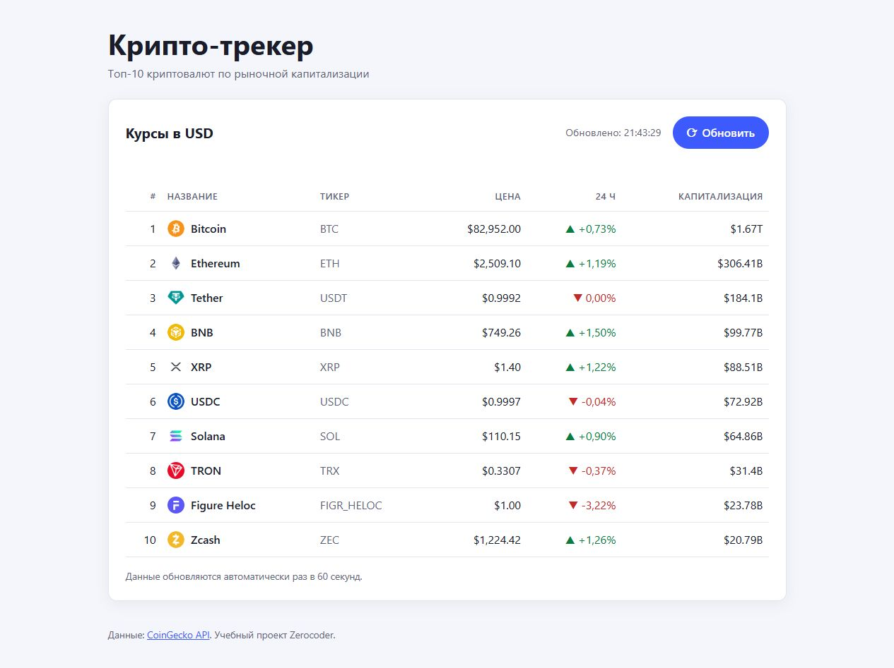

# Крипто-трекер

Учебный проект Zerocoder: одностраничный сайт, который показывает топ-10 криптовалют по рыночной капитализации в реальном времени.

Проект выполнен для урока **PEs06.1 «Claude Code»** курса «Промпт-инжиниринг 3.0» на [zerocoder.ru](https://zerocoder.ru/).



## Возможности

- Название, тикер, цена в USD, изменение за 24 часа и капитализация.
- Данные из публичного [CoinGecko API](https://www.coingecko.com/en/api) (ключ не нужен).
- Автоматическое обновление раз в 60 секунд, кнопка ручного обновления, время последнего обновления.
- Состояния загрузки (скелетон) и ошибки (с кнопкой «Повторить»).
- Семантичная и доступная разметка, адаптивная вёрстка, светлая и тёмная тема.
- Без фреймворков и сборки: HTML, CSS и JavaScript ES-модуль.

## Структура

```
index.html   — разметка страницы
styles.css   — стили
app.js       — загрузка и отрисовка данных (ES-модуль)
README.md    — эта инструкция
```

## Запуск

ES-модули не работают при открытии файла через `file://`, поэтому нужен локальный HTTP-сервер.

1. Установите [Node.js](https://nodejs.org/) (версия 18 или новее).
2. В папке проекта выполните:

   ```bash
   npx serve .
   ```

3. Откройте в браузере адрес из вывода команды (обычно http://localhost:3000).

Если локальная установка `serve` повреждена или `npx serve` не запускается, используйте резервный вариант:

```bash
python -m http.server 4173 --bind 127.0.0.1
```

После этого откройте http://127.0.0.1:4173.

## Примечания

- У бесплатного API CoinGecko есть лимит запросов. При ответе 429 страница покажет сообщение об ошибке, а следующая попытка будет через минуту.
- Внешние данные выводятся только через `textContent` и DOM-API, без `innerHTML`.
- Фактическая проверка 10.10.2026 выполнена через локальный HTTP-сервер Python: CoinGecko вернул 10 записей, таблица и ручное обновление отобразились в браузере.

## Лицензия

Проект распространяется по лицензии [MIT](LICENSE).
